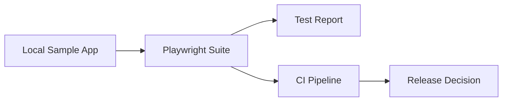

# Enterprise QA Automation Blueprint

[](https://github.com/acbharath14/enterprise-qa-automation-blueprint/actions/workflows/e2e.yml)

A Playwright + TypeScript test framework built around a simple idea: smoke tests should produce a release signal, not just a pass/fail log. The suite runs against **DemoMart**, a small local e-commerce sample app (product catalog, cart, checkout, orders API), and the results feed into CI quality gates.

**Who this is for:** testers and SDETs who want a working reference for how UI, API, accessibility, visual, performance, and security checks fit together in one suite — and a starting point they can adapt to their own application. If you are new to Playwright, start with [Getting started](#getting-started), then read [Repository tour](#repository-tour).

**Latest test reports** — published from every `main` run:
- [Playwright HTML report](https://acbharath14.github.io/enterprise-qa-automation-blueprint/) (per-shard)
- [Allure report](https://acbharath14.github.io/enterprise-qa-automation-blueprint/allure/) (trends, retries, history)
- [Failure showcase](https://acbharath14.github.io/enterprise-qa-automation-blueprint/playwright-report-showcase/) — two intentional failures ([Allure view](https://acbharath14.github.io/enterprise-qa-automation-blueprint/allure/) under **Showcase › Intentional failures**), demonstrating failure capture (assertion diff, screenshot, video, trace)

## Architecture



## Repository tour

```
.
├── playwright-suite/
│   ├── sample-app/index.html        # DemoMart storefront under test: catalog (search/filter/sort),
│   │                                # product detail, cart, checkout wizard, order confirmation,
│   │                                # demo login — responsive, 130+ data-testid hooks
│   ├── server.mjs                   # tiny Node server: serves the app + store JSON API (products
│   │                                # CRUD, server-side cart, orders, login) with security headers.
│   │                                # Carts are isolated per test via the X-Cart-Id header.
│   ├── global-setup.ts              # decodes the base64 visual baseline before tests run
│   ├── scripts/update-baseline.mjs  # re-encodes the PNG after regenerating the baseline
│   ├── pages/                       # Page Objects: CatalogPage, ProductPage, CartPage,
│   │                                # CheckoutPage, LoginPage — every selector lives here, never in tests
│   ├── fixtures/test.ts             # custom fixtures: catalogPage / productPage / cart / checkout /
│   │                                # loginPage, already navigated and ready — tests start interacting,
│   │                                # not waiting. The cart/checkout fixtures pin the page's session
│   │                                # cart to a known id so UI and API calls share one isolated cart.
│   ├── tests/                       # one spec file per test type (see Test coverage below)
│   │   ├── helpers/cart.ts          # pageCartHeaders(): bridges UI tests' session cart to direct API calls
│   │   ├── helpers/order-retry.ts   # set-semantics cart repair + order placement helpers
│   │   ├── visual.spec.ts-snapshots/ # baseline PNG, materialized at test time (see below)
│   │   └── accessibility.spec.ts-snapshots/ # committed aria snapshot of the checkout form
│   ├── test-data/openapi.store.json # OpenAPI 3.0.3 document for the store API (drives schema validation)
│   ├── test-data/visual-baseline.b64.partN   # the visual baseline, versioned as base64 text
│   ├── test-data/factory.ts         # seedable data factory (mulberry32 PRNG): makeProducts(n, seed)
│   │                                # is identical on every run, varied across seeds
│   ├── test-data/schema-validator.ts   # reusable AJV helper: validates a response against the
│   │                                    # OpenAPI document (local $refs, {param} path templates)
│   ├── playwright.config.ts         # projects (chromium/firefox/webkit/mobile/dark/tz/authed + auth
│   │                                # setup), retries, reporters, trace+video-on-failure, auto-started webServer
│   └── package.json                 # scripts: test, test:smoke, test:a11y, test:headed, report,
│                                    # baseline:update
├── docs/
│   ├── decisions.md                 # why the framework is shaped this way — read this for the reasoning
│   ├── architecture.md              # layered quality model and design principles
│   └── evidence.md                  # sample passing run output
├── k6/                               # k6 smoke/load/stress tests against the store API
├── newman/                           # Postman collection: store API health checks, run hourly in CI
├── ci/                              # GitLab CI and Jenkins pipeline templates
└── .github/workflows/e2e.yml        # GitHub Actions: sharded runs, HTML + Allure reports, Pages deploy
```

The pattern to notice: **tests describe behavior, page objects describe the UI, fixtures remove boilerplate, data lives in files.** When you adapt this to your app, you will mostly touch `pages/`, `tests/`, and `playwright.config.ts`.

## Getting started

**Prerequisites:** Node.js 20 or newer (`node --version` to check).

```bash
# 1. Clone and install
git clone https://github.com/acbharath14/enterprise-qa-automation-blueprint.git
cd enterprise-qa-automation-blueprint/playwright-suite
npm install

# 2. Install the browsers Playwright drives (one-time download)
npx playwright install chromium
# On Linux you may need: npx playwright install --with-deps chromium (uses sudo)

# 3. Run the suite
npm test
```

The sample app starts automatically — `playwright.config.ts` launches `node server.mjs` before the tests and shuts it down after. There is nothing else to start.

After the run, open the HTML report:

```bash
npm run report
```

You should see all specs listed with pass/fail, timings, and (for failures) traces and screenshots.

## Test coverage

| Type | File | What it proves |
|---|---|---|
| Smoke | `tests/store-smoke.spec.ts` | Critical paths work: catalog renders, add-to-cart updates the badge, cart totals are correct, checkout completes with an order id, demo login works (`@smoke`) |
| Catalog | `tests/catalog.spec.ts` | Product grid renders the seeded catalog; search, category filter, and sorting drive it correctly |
| Accessibility | `tests/accessibility.spec.ts` | axe-core scan, WCAG 2A/2AA (`@a11y` tag) + committed aria snapshot of the checkout form |
| Keyboard | `tests/keyboard.spec.ts` | Tab order, focus, Enter/Space activation — what axe-core can't check |
| Mobile | `tests/mobile.spec.ts` | `@mobile` tag: viewport meta tag, no horizontal overflow at 375px, touch-tap actions, hamburger nav — on the Pixel 7 `mobile` project (`npm run test:mobile`) or a real iPhone via the opt-in `browserstack` project (see below) |
| API | `tests/api.spec.ts` | Store API contract: products CRUD, cart math, order lifecycle, JSON error shapes. Each test gets an isolated cart via the `X-Cart-Id` header, so parallel workers never interfere |
| API schema | `tests/api-schema.spec.ts` | Every store endpoint validates against `test-data/openapi.store.json` via the reusable AJV `validateResponse` helper — including negative cases (wrong types, extra/missing fields) and loud failures on undocumented paths |
| Contract | `contract/pact-store.spec.ts` | Pact consumer + provider verification for the store API (`GET /api/products`, `POST /api/cart/items`, `POST /api/orders`, …) via `npm run test:contract`; contract files are committed at `contract/pacts/` |
| API mocking | `tests/api-mocked.spec.ts` | UI behavior when the products API returns 500s or slow responses |
| Integration | `tests/integration.spec.ts` | UI calls the right API and renders its response (`waitForResponse`); attaches the raw response to the report |
| Offline | `tests/offline.spec.ts` | Friendly message when the API is unreachable |
| Forms | `tests/forms.spec.ts` | Checkout validation: inline errors (soft assertions); valid submit sends the exact expected POST payload; `test.step` structure |
| Radio group | `tests/radio.spec.ts` | Shipping/payment method radios: fieldset/legend semantics, single selection, arrow-key navigation |
| Auth | `tests/auth.spec.ts` + `auth.setup.ts` | Demo login success/failure (`admin`/`secret`); setup project saves `storageState` reused by `authed.spec.ts` |
| Upload | `tests/upload.spec.ts` | Product image upload round-trip (`POST /api/products/:id/image`, multipart) |
| Dialogs | `tests/dialogs.spec.ts` | Native confirm on cart-line remove: message content, accept and dismiss paths |
| Modal | `tests/modal.spec.ts` | Quick-view dialog: focus trap, ESC/backdrop close, focus return |
| Table | `tests/table.spec.ts` | Catalog sorting ascending/descending |
| Tabs | `tests/tabs.spec.ts` | Product-detail tabs (Description/Reviews/Shipping): ARIA tablist, arrow-key navigation |
| Search | `tests/search.spec.ts` | Catalog search: debounced results, keyboard selection, ARIA states |
| Loading skeletons | `tests/skeletons.spec.ts` | Catalog load shows skeleton placeholders, then real products replace them |
| Date picker | `tests/datepicker.spec.ts` | Checkout delivery-date picker: fill and confirmation |
| Wizard | `tests/wizard.spec.ts` | Multi-step checkout: per-step validation, back/next, review and submit (`test.step` structure) |
| Toast | `tests/toast.spec.ts` | Added-to-cart notification appears and auto-dismisses |
| Accordion | `tests/accordion.spec.ts` | Shipping & returns accordion: aria-expanded, click + Enter/Space keyboard |
| Pagination | `tests/pagination.spec.ts` | Catalog pagination: next/prev, page numbers, disabled states |
| Dropdown | `tests/dropdown.spec.ts` | Category filter: option selection drives the grid, keyboard support |
| Download | `tests/download.spec.ts` | Order receipt CSV download: filename and file content assertions |
| Empty states | `tests/empty-states.spec.ts` | Zero-match search shows no-results; empty cart shows the cart-empty message |
| Tooltips | `tests/tooltips.spec.ts` | Product-card tooltips: hover/focus reveals, ESC dismisses, aria-describedby association |
| iFrame | `tests/iframe.spec.ts` | Same-origin payment frame in checkout via `frameLocator` |
| Shadow DOM | `tests/shadowdom.spec.ts` | Star-rating web component inside an open shadow root (Playwright pierces it automatically) |
| Controls | `tests/controls.spec.ts` | Price-range slider updates its output; theme toggle flips design tokens |
| Datetime | `tests/datetime.spec.ts` | Order timestamp rendering under emulated locale/timezone (`tz` project: Pacific/Auckland, en-NZ) |
| Popup | `tests/popup.spec.ts` | View-receipt opens the receipt in a new tab (`waitForEvent('popup')`); new page is asserted and closed |
| Visual | `tests/visual.spec.ts` | Storefront layout regression vs. committed baseline (dynamic regions masked; chromium-only) |
| Theme | `tests/theme.spec.ts` | Dark/light toggle flips design tokens across the storefront |
| Performance | `tests/performance.spec.ts` | Load budgets, API latency budget, zero console/page errors |
| Web Vitals | `tests/web-vitals.spec.ts` | Core Web Vitals via PerformanceObserver: LCP < 2.5s, CLS < 0.1, INP < 200ms (Google's "good" thresholds) |
| Load / stress | `k6/` | k6 smoke, load (50 VUs, SLO thresholds), and stress (to 300 VUs) tests against the store API — see `k6/README.md` |
| API health checks | `newman/` | Postman collection (7 requests, 17 assertions) for the store API, run hourly via Newman in CI; HTML report + email alert on failure — see `newman/README.md` |
| Security | `tests/security.spec.ts`, `tests/pentest.spec.ts` | Security headers, JSON 404s, no reflection of untrusted input; attack simulations (`npx playwright test --grep @pentest`): SQLi/NoSQLi/XSS/traversal payload batteries, login attacks, cart quantity abuse, clickjacking headers |
| Test data | `test-data/factory.ts` (+ `tests/factory.spec.ts`) | Seedable data factory (mulberry32 PRNG): `makeProducts(n, seed)` is identical on every run, varied across seeds; generates products/carts/orders matching the store API shapes |

**Understanding the test types:** each spec file focuses on one quality attribute so failures point at the *kind* of problem, not just the page. `store-smoke.spec.ts` answers "is the app up?"; `api.spec.ts` answers "is the contract intact?"; `visual.spec.ts` answers "did the layout change?". When you add coverage for your app, follow the same rule — one file per question.

## Running tests

```bash
npm test                          # everything: 8 projects (chromium/firefox/webkit/mobile/dark/tz/authed + setup)
npm run test:smoke                 # only @smoke tagged tests — the fast release signal
npm run test:a11y                  # only @a11y tagged tests
npm run test:headed                # watch chromium run in a visible browser
npm run test:browserstack         # real device via BrowserStack (needs credentials + Local tunnel)
npm run test:contract              # Pact contract tests (separate config, no browsers)
npx playwright test tests/api.spec.ts                 # a single file
npx playwright test --project=firefox                 # a single project
npx playwright test --project=chromium --headed       # headed, one browser
npx playwright test --debug tests/store-smoke.spec.ts      # step-through debugging
```

> **macOS note:** Playwright 1.64+ no longer ships Chromium for macOS 13 (Ventura).
> If `npx playwright install chromium` fails with "Playwright does not support chromium on mac13",
> use your installed Chrome instead:
> ```bash
> USE_SYSTEM_CHROME=1 npx playwright test --project=chromium
> ```

### Real devices (BrowserStack)

The `mobile` project is emulation. For a real device, the framework ships an
opt-in `browserstack` project — the specs run unchanged; Playwright just
connects to a real iPhone over CDP instead of launching a local browser.

```bash
# 1. Start the BrowserStack Local tunnel (the device reaches your
#    localhost sample app through it):
./BrowserStackLocal --key $BROWSERSTACK_ACCESS_KEY

# 2. In another terminal, run the mobile specs on a real iPhone:
BROWSERSTACK_USERNAME=you BROWSERSTACK_ACCESS_KEY=xxx npm run test:browserstack
```

- The project only exists when both env vars are set — without them,
  `npx playwright test` behaves exactly as before.
- It targets an iPhone via WebKit (`browser: 'safari'` caps). Device and OS
  are configurable: `BROWSERSTACK_DEVICE='iPhone 14' BROWSERSTACK_OS_VERSION=16`.
- Real Android needs Playwright's experimental `_android` API, which can't be
  expressed in config — so the project is iOS-only for now.
- The project only runs `@mobile`-tagged specs — enforced in the config, so
  even a bare `npx playwright test --project=browserstack` can't accidentally
  burn device minutes on the desktop suite.
- CI: add the two values as repository secrets and start the Local tunnel
  (BrowserStack's `setup-local` GitHub Action) before `npm run test:browserstack`.
  See `.github/workflows/browserstack.yml`.
- iOS quirk, handled in the config: iPhones resolve `localhost`/`127.0.0.1` on
  the device itself, so the project navigates via `http://bs-local.com:4173`,
  which resolves through the tunnel to your machine. Keep the tunnel running;
  nothing else to configure.

### Targeting other environments

`TEST_ENV` selects which env file loads from `playwright-suite/env/`:

```bash
TEST_ENV=staging npx playwright test     # uses env/.env.staging
TEST_ENV=prod npm run test:smoke         # smoke only against prod
```

- `dev` (default) points at the local sample app (`http://127.0.0.1:4173`).
- `staging` / `prod` ship as placeholders — replace the URLs with yours.
- Never run write-heavy specs (wizard, upload, feedback) against prod unless
  prod is the intended target; `test:smoke` and `test:contract` are the safe
  read-only choices there.

**Regenerating the visual baseline** (after an intentional UI change):

```bash
npx playwright test visual --project=chromium --update-snapshots
npm run baseline:update
```

The first command re-captures the PNG; the second re-encodes it into `test-data/visual-baseline.b64.partN`, which is the file actually committed. The PNG itself is materialized from that text by `global-setup.ts` before every run, so a fresh clone needs no manual steps. Review the new screenshot before committing — a baseline update should be a deliberate, reviewed change.

## Make it yours

Adapting this framework to your application is three steps. Here is each one with a concrete example.

**1. Point it at your app.** For a deployed environment, override the base URL — no config edit needed:

```bash
BASE_URL=https://staging.myapp.com npx playwright test
```

(When you stop using the sample app, delete the `webServer` block in `playwright.config.ts` — it only exists to serve the demo.)

**2. Add a page object.** Selectors and page actions live in `pages/`, never in test files:

```ts
// playwright-suite/pages/LoginPage.ts
import { Page, Locator } from '@playwright/test';

export class LoginPage {
  readonly username: Locator;
  readonly password: Locator;
  readonly submit: Locator;

  constructor(private page: Page) {
    this.username = page.getByLabel('Username');
    this.password = page.getByLabel('Password');
    this.submit = page.getByRole('button', { name: 'Sign in' });
  }

  async goto() {
    await this.page.goto('/login');
  }

  async login(user: string, pass: string) {
    await this.username.fill(user);
    await this.password.fill(pass);
    await this.submit.click();
  }
}
```

**3. Write a spec using the fixture.** Tests describe behavior in plain steps:

```ts
// playwright-suite/tests/login.spec.ts
import { test, expect } from '@playwright/test';
import { LoginPage } from '../pages/LoginPage';

test('user can sign in @smoke', async ({ page }) => {
  const login = new LoginPage(page);
  await login.goto();
  await login.login('tester', 's3cret');
  await expect(page.getByText('Welcome')).toBeVisible();
});
```

Tag it (`@smoke`, `@a11y`) if it belongs in a filtered run, data-drive it from `test-data/` if it has many cases, and add the reasoning to `docs/decisions.md` so the next person understands *why*.

## How CI Works

Every push/PR touching `playwright-suite/` runs the suite split across 2 shards (4 workers each) covering all 8 projects. HTML and Allure reports are uploaded as artifacts per shard. On `main`, the merged report publishes to [GitHub Pages](https://acbharath14.github.io/enterprise-qa-automation-blueprint/). A scheduled run every Monday keeps the badge honest.

**Failure debugging:** Each shard writes a failure summary table (test name + first error line) to the GitHub Step Summary on the run page — no artifact download needed for triage. The email notification includes a visual pass/fail bar and deduplicated counts (retries count once, by final outcome).

### GitLab CI on a self-hosted runner

The same pipeline runs on GitLab CI via `.gitlab-ci.yml` — a port of the GitHub workflow with the same five jobs: sharded Playwright tests, the GO/NO-GO quality gate, Pact contract tests, report publishing, and the Resend email summary.

GitHub remains the source of truth. The `mirror-to-gitlab.yml` workflow pushes `main` and tags to the GitLab project on every push — a push mirror, because GitLab pull mirroring requires a Premium tier. Jobs run on a self-hosted GitLab Runner (Docker executor, tagged `imac,docker`); the Playwright Docker image ships the browsers, so there is no install step.

Setup on the GitLab project: two masked CI/CD variables (`RESEND_API_KEY`, `ALERT_TO`), and any scheduled runs as pipeline schedules in the GitLab UI. Reports publish to GitLab Pages.

## Troubleshooting

| Symptom | Fix |
|---|---|
| `Executable doesn't exist` on first run | `npx playwright install chromium` (browsers are a separate download) |
| `EADDRINUSE` on port 4173 | another copy of the sample server is running: `lsof -ti:4173 \| xargs kill` |
| Visual test fails after you changed the UI | intentional — regenerate the baseline (see above) and commit it |
| Tests pass locally but fail in CI | check for timing assumptions and unmasked dynamic content; open the trace from the CI artifact |
| `npm test` feels slow | run a slice: `npm run test:smoke` or `--project=chromium` while developing |
| Page shows raw text instead of rendering | `index.html` was pushed base64-encoded — push raw HTML content via the API, not base64 |
| `getByLabel` matches multiple elements | another component uses the same label text — use `getByRole` with a specific role, or scope to a region |
| Allure shows skips as failures | use `testIgnore` in the Playwright config for browser-exclusive tests instead of `test.skip()` |

## License

MIT — see [LICENSE](LICENSE).
